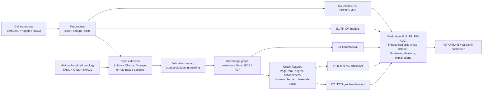

# From Call Transcripts to Knowledge Graphs: LLM-Powered Phone Scam Detection

CSE 573 Semantic Web Mining - Project P10 (Fraud Detection with Graph Databases).
This repository implements the full proposal: a minimal fraud-call ontology, ontology-guided LLM triple
extraction, a Neo4j / RDF knowledge graph, leak-safe graph features, classical + graph-enhanced
classifiers (E1/E2), transformer baselines (E3), GraphSAGE (E4), unsupervised script discovery (E5),
extraction-quality evaluation (X1), cross-dataset generalization (X2), ablations, significance tests,
per-call KG explanations and a results dashboard.



## Proposal -> implementation map

| Proposal item | Command | Code |
|---|---|---|
| Phase 1: cleaning, label unification, stratified splits, EDA | `download`, `preprocess`, `eda` | `scamkg/data/` |
| Phase 2: minimal ontology (Table II) | - | `ontology/ontology.yaml`, `ontology/fraud_call_ontology.ttl`, `ontology/shapes.ttl` |
| Phase 3: LLM KG extraction (JSON schema, retry, standardization, inferred edges), 2 LLMs + prompt ablation | `extract --extractor llm --model A B --prompt-version ...` | `scamkg/extraction/` |
| Phase 4: Neo4j load, GDS degree / PageRank / betweenness / Louvain / node similarity, leak-safe community scam rate | `build-graph [--backend neo4j]` | `scamkg/graph/` |
| E1 TF-IDF + LR / SVM / RF / XGBoost | `train --experiments E1` | `scamkg/models/classical.py` |
| E2 E1 + graph features + one-hot ontology entities (and E2G: KG features only) | `train --experiments E2 E2G` | `scamkg/models/classical.py` |
| E3 fine-tuned DistilBERT, Sentence-BERT + MLP | `train --experiments E3` | `scamkg/models/transformer.py` |
| E4 GraphSAGE (2 layers, mean aggr., 64 hidden, dropout 0.3, Adam); end-to-end and as XGBoost embedding generator | `train --experiments E4` | `scamkg/models/gnn.py` |
| E5 K-Means / DBSCAN, purity, NMI, script signatures | `cluster` | `scamkg/models/clustering.py` |
| LLM zero-shot reference | `zeroshot` | `scamkg/models/llm_zeroshot.py` |
| X1 extraction quality (2 annotators x 50 calls; triple P/R, entity-type accuracy, JSON validity, schema conformance) | `annotate-sample`, `eval-extraction` | `scamkg/extraction/evaluate.py` |
| X2 cross-dataset (train BothBosu, test Kaggle + NCSU) | automatic in every `train` | `scamkg/evaluation/evaluator.py` |
| Realistic ~5% scam test split | automatic (`test_imbalanced`, mean +- std over 20 draws) | `scamkg/evaluation/evaluator.py` |
| 5-fold stratified CV, McNemar test | `cv`, `significance` | `scamkg/models/classical.py`, `scamkg/evaluation/stats.py` |
| Ablations: each entity type, each feature group | `ablate` | `scamkg/evaluation/ablation.py` |
| Explainability: identity-tactic-asset path per flagged call | `explain`, `predict`, dashboard | `scamkg/evaluation/explain.py`, `scamkg/predict.py` |
| Stretch: fraudster / salesperson / prankster via LLM relabeling | `relabel`, `multiclass` | `scamkg/models/llm_zeroshot.py` |
| Optional BankSim reference baseline | `banksim` | `scamkg/models/banksim.py` |
| Deliverables: ontology, KG, Neo4j dump, models, dashboard, report | `build-graph`, `report`, `dashboard` | `results/`, `data/kg/`, `artifacts/` |

## Setup

Python 3.11+ (tested with 3.14 on Windows).

```bash
python -m venv .venv
```

```bash
.venv\Scripts\python -m pip install -r requirements.txt
```

Optional deep-learning extras for E3/E4 (install PyTorch first; CPU build shown):

```bash
.venv\Scripts\python -m pip install torch --index-url https://download.pytorch.org/whl/cpu
```

```bash
.venv\Scripts\python -m pip install -r requirements-deep.txt
```

Copy `.env.example` to `.env` and fill in what you use (Ollama URL, ASU Voyager URL + key, Neo4j password).
On macOS/Linux use `.venv/bin/python` instead of `.venv\Scripts\python`.

## Quick start: offline demo

Runs the whole pipeline in a few minutes on synthetic, template-generated calls (no downloads, LLM
server or Neo4j). The demo only exercises the code: its numbers are **not** evidence for the RQs.

```bash
.venv\Scripts\python -m scamkg --config config/demo.yaml run-all --regenerate
```

```bash
.venv\Scripts\python -m scamkg --config config/demo.yaml dashboard
```

Outputs go to `data/demo/`, `results/demo/` (see `results/demo/REPORT.md`) and `artifacts/demo/`.

## Running on the real data

1. **Data** (Table I). BothBosu and NCSU download automatically. For Kaggle, either set
   `data.sources.kaggle.slug` in `config/config.yaml` (Kaggle CLI is used) or put the CSV into
   `data/raw/kaggle/`; column names are auto-detected (override with `text_col`, `label_col`, `id_col`).

   ```bash
   .venv\Scripts\python -m scamkg download
   ```

   ```bash
   .venv\Scripts\python -m scamkg preprocess
   ```

   ```bash
   .venv\Scripts\python -m scamkg eda
   ```

2. **LLM setup.** Pull the two open-source models (or point `llm.provider: voyager` at ASU Voyager's
   OpenAI-compatible endpoint via `VOYAGER_BASE_URL` / `VOYAGER_API_KEY`). Pilot on 20 calls first:

   ```bash
   ollama pull qwen2.5:7b
   ```

   ```bash
   ollama pull gemma2:9b
   ```

   ```bash
   .venv\Scripts\python -m scamkg extract --extractor llm --model qwen2.5:7b --limit 20
   ```

3. **Full extraction**, comparing two LLMs, a prompt ablation, and the rule-based baseline. Runs resume
   after interruption, every response is cached in `data/cache/llm/`, and each run records model,
   prompt version + hash, seed and temperature in `<run>.meta.json`.

   ```bash
   .venv\Scripts\python -m scamkg extract --extractor llm --model qwen2.5:7b gemma2:9b
   ```

   ```bash
   .venv\Scripts\python -m scamkg extract --extractor llm --model qwen2.5:7b --prompt-version v2_no_descriptors v3_no_example v0_open --splits test
   ```

   ```bash
   .venv\Scripts\python -m scamkg extract --extractor rule
   ```

4. **X1 annotation.** `annotate-sample` writes `data/annotations/sample.jsonl` plus empty
   `annotator_A.jsonl` / `annotator_B.jsonl` and a guide (`data/annotations/README.md`). Two members
   annotate independently; the adjudicated version goes into `gold.jsonl`.

   ```bash
   .venv\Scripts\python -m scamkg annotate-sample --n 50
   ```

   ```bash
   .venv\Scripts\python -m scamkg eval-extraction
   ```

5. **Knowledge graph.** The run used is `extraction.default_run` in the config, else the most recent run
   with full coverage (pilot runs are never picked silently), or pass `--run <name>`.

   ```bash
   .venv\Scripts\python -m scamkg build-graph --run llm_ollama_qwen2.5-7b_v1_full
   ```

   With Neo4j + Graph Data Science instead of networkx (see below):

   ```bash
   .venv\Scripts\python -m scamkg build-graph --backend neo4j
   ```

6. **Models and evaluation.**

   ```bash
   .venv\Scripts\python -m scamkg train
   ```

   ```bash
   .venv\Scripts\python -m scamkg cv
   ```

   ```bash
   .venv\Scripts\python -m scamkg significance
   ```

   ```bash
   .venv\Scripts\python -m scamkg ablate
   ```

   ```bash
   .venv\Scripts\python -m scamkg zeroshot --model qwen2.5:7b
   ```

   ```bash
   .venv\Scripts\python -m scamkg explain
   ```

   ```bash
   .venv\Scripts\python -m scamkg report
   ```

   ```bash
   .venv\Scripts\python -m scamkg dashboard
   ```

   Or everything at once: `.venv\Scripts\python -m scamkg run-all --extractor llm --model qwen2.5:7b`.

7. **Stretch goal (three-way labels).**

   ```bash
   .venv\Scripts\python -m scamkg relabel --model qwen2.5:7b
   ```

   ```bash
   .venv\Scripts\python -m scamkg multiclass
   ```

Score any new transcript with a trained model and get its KG explanation:

```bash
.venv\Scripts\python -m scamkg predict --text "caller: This is the IRS, pay today with gift cards or you will be arrested."
```

## Neo4j

```bash
docker compose up -d neo4j
```

Neo4j Browser is at http://localhost:7474 (user `neo4j`, password from `.env`). `build-graph --backend neo4j`
loads `(:Call)-[:CLAIMS_TO_BE|MENTIONS_ORG|USES_TACTIC|REQUESTS|PAY_VIA|PROVIDES_NUMBER]->(entity)`,
writes `SIMILAR_TO` edges with `gds.nodeSimilarity` and `community` with `gds.louvain`, and streams
degree / PageRank / betweenness back into the pipeline. Example queries: `neo4j/queries.cypher`.
Database dump for the deliverable:

```bash
docker compose stop neo4j
```

```bash
docker compose run --rm neo4j neo4j-admin database dump neo4j --to-path=/dumps
```

The dump lands in `neo4j/dumps/`. Without Docker, any Neo4j 5 server with the GDS plugin works.

## Semantic-web artefacts

* `ontology/fraud_call_ontology.ttl` - OWL T-box (classes, object/datatype properties, disjointness).
* `ontology/ontology.yaml` - vocabularies, synonyms and organization aliases used for prompts and standardization.
* `data/kg/rdf/kg__<run>.ttl` - the KG as RDF (controlled values as SKOS concepts, inferred/evidence
  facts as reified `rdf:Statement`s), validated against `ontology/shapes.ttl` when `pyshacl` is installed.
* `ontology/queries.sparql` - example SPARQL, run with `python -m scamkg sparql`.

## Outputs

| File | Content |
|---|---|
| `data/processed/calls.jsonl` | unified, cleaned calls with splits |
| `data/kg/extractions/<run>.jsonl` + `.meta.json` | triples per call and run statistics |
| `data/kg/kg__<run>.graphml`, `nodes__*.csv`, `edges__*.csv`, `rdf/` | KG exports (Gephi / Neo4j import / RDF) |
| `results/metrics.csv` | every model x evaluation set (test, test_imbalanced, each external set) |
| `results/predictions/*.csv` | per-call scores of every model |
| `results/cv_results.csv`, `significance.csv`, `generalization.csv` | CV mean +- std, McNemar, recall drop |
| `results/extraction_quality.csv` | X1 per extraction run |
| `results/clustering.json`, `scam_scripts.md` | E5 metrics and discovered scripts |
| `results/ablation.csv` | entity-type and feature-group ablations |
| `results/explanations.jsonl` | KG evidence for flagged calls |
| `results/REPORT.md`, `results/figures/`, `results/eda/` | report tables and figures |
| `artifacts/models/` | trained models (`joblib`, DistilBERT, GraphSAGE) |

## Leakage safeguards and reproducibility

* Graph structure (PageRank, degree, betweenness, Louvain, Jaccard) is label-free.
* Every label-derived feature (community scam rate, similarity to known scams, k-NN scam rate, entity
  risk) is rebuilt for each training set from **training labels only** (train for tuning, train+val for
  the final model, the fold's train part in CV), with leave-one-out values for training calls
  (`tests/test_features.py`).
* Hyper-parameters are tuned by randomized search on the validation split only.
* LLM extraction: temperature 0.1, fixed seed, capped output length, JSON validation with retry, schema
  repair, entity standardization, and a grounding check that drops triples whose evidence/mention is not
  in the transcript (e.g. content copied from the few-shot example). Inferred facts are flagged.
* Everything is seeded (`project.seed`); results rows record the extraction run used.

## Repository layout

```
config/          config.yaml (real data), demo.yaml (synthetic demo overrides)
ontology/        ontology.yaml, OWL (Turtle), SHACL shapes, SPARQL examples
scamkg/          the package (python -m scamkg --help)
  data/          download, loaders, preprocessing, EDA, synthetic demo generator
  extraction/    prompts, Ollama/OpenAI-compatible clients, LLM + rule extractors, X1 evaluation
  graph/         KG construction, graph features, Neo4j/GDS store, RDF export, plots
  models/        classical (E1/E2/E2G), transformers (E3), GraphSAGE (E4), clustering (E5), LLM zero-shot, BankSim
  evaluation/    metrics, evaluator, McNemar, ablations, explanations, report
  predict.py     score a new transcript end-to-end
dashboard/       Streamlit results dashboard
neo4j/           Cypher examples (data/dumps created by docker compose)
tests/           pytest suite (runs offline on synthetic data)
```

## Team responsibilities (proposal Table V)

| Member | Code |
|---|---|
| Hemalasya Annapureddy | `ontology/`, `scamkg/extraction/` (prompts, extractors, X1) |
| Hemanth Reddy Gundepally | `scamkg/data/` (download, loaders, preprocessing, EDA) |
| Sreeja Sunkeswaram | `scamkg/graph/` (Neo4j/GDS, features, RDF, visualizations) |
| Varun Javvaji | `scamkg/models/classical.py`, `clustering.py`, `scamkg/evaluation/stats.py` |
| Vishnu Honnavalli | `scamkg/models/transformer.py`, `gnn.py`, `llm_zeroshot.py` |

## Tests

```bash
.venv\Scripts\python -m pytest
```

## Notes

* The NCSU robocall set contains only illegal robocalls (label 1), so only recall is defined on it alone;
  the `ncsu+kaggle` evaluation set pairs its calls with Kaggle's legitimate calls for PR-AUC.
* `data.sources.kaggle.slug` is left empty because the proposal does not name the Kaggle owner; set it
  once the team fixes the exact data set.
* Small local models (e.g. `qwen2.5:0.5b`) produce valid JSON but noisy, sometimes copied triples; use
  7B+ models (or Voyager) for the real extraction runs.
