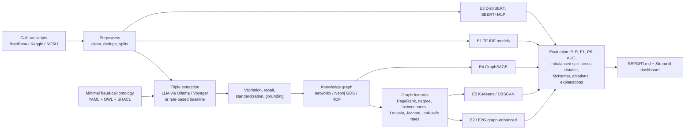

# From Call Transcripts to Knowledge Graphs: LLM-Powered Phone Scam Detection

CSE 573 Semantic Web Mining - Project P10 (Fraud Detection with Graph Databases).
This repository implements the full proposal: a minimal fraud-call ontology, ontology-guided LLM triple
extraction, a Neo4j / RDF knowledge graph, leak-safe graph features, classical + graph-enhanced
classifiers (E1/E2), transformer baselines (E3), GraphSAGE (E4), unsupervised script discovery (E5),
extraction-quality evaluation (X1), cross-dataset generalization (X2), ablations, significance tests,
per-call KG explanations and a results dashboard.



## Proposal -> implementation map

| Proposal item | Command | Code |
|---|---|---|
| Phase 1: cleaning, label unification, stratified splits, EDA | `download`, `preprocess`, `eda` | `scamkg/data/` |
| Phase 2: minimal ontology (Table II) | - | `ontology/ontology.yaml`, `ontology/fraud_call_ontology.ttl`, `ontology/shapes.ttl` |
| Phase 3: LLM KG extraction (JSON schema, retry, standardization, inferred edges), 2 LLMs + prompt ablation | `extract --extractor llm --model A B --prompt-version ...` | `scamkg/extraction/` |
| Phase 4: Neo4j load, GDS degree / PageRank / betweenness / Louvain / node similarity, leak-safe community scam rate | `build-graph [--backend neo4j]` | `scamkg/graph/` |
| E1 TF-IDF + LR / SVM / RF / XGBoost | `train --experiments E1` | `scamkg/models/classical.py` |
| E2 E1 + graph features + one-hot ontology entities (and E2G: KG features only) | `train --experiments E2 E2G` | `scamkg/models/classical.py` |
| E3 fine-tuned DistilBERT, Sentence-BERT + MLP | `train --experiments E3` | `scamkg/models/transformer.py` |
| E4 GraphSAGE (2 layers, mean aggr., 64 hidden, dropout 0.3, Adam) on fused text + topology node features, inductive training; end-to-end, as XGBoost embedding generator, and text / topology block ablation | `train --experiments E4` | `scamkg/models/gnn.py` |
| E5 K-Means / DBSCAN, purity, NMI, script signatures | `cluster` | `scamkg/models/clustering.py` |
| LLM zero-shot reference | `zeroshot` | `scamkg/models/llm_zeroshot.py` |
| X1 extraction quality (2 annotators x 50 calls; triple P/R, entity-type accuracy, JSON validity, schema conformance) | `annotate-sample`, `eval-extraction` | `scamkg/extraction/evaluate.py` |
| X2 cross-dataset (train BothBosu, test Kaggle + NCSU) | automatic in every `train` | `scamkg/evaluation/evaluator.py` |
| Realistic ~5% scam test split | automatic (`test_imbalanced`, mean +- std over 20 draws) | `scamkg/evaluation/evaluator.py` |
| 5-fold stratified CV, McNemar test | `cv`, `significance` | `scamkg/models/classical.py`, `scamkg/evaluation/stats.py` |
| Generalization to unseen scam scripts / legitimate call types (leave-one-type-out) | `loto` | `scamkg/models/classical.py` |
| Ablations: each entity type, each feature group | `ablate` | `scamkg/evaluation/ablation.py` |
| Explainability: identity-tactic-asset path per flagged call | `explain`, `predict`, dashboard | `scamkg/evaluation/explain.py`, `scamkg/predict.py` |
| Caller type: fraudster / salesperson / prankster / other legitimate (BothBosu types + generated prank calls; LLM relabeling for other data) | `generate-pranks`, `run-multiclass`, `multiclass`, `relabel` | `scamkg/data/pranks.py`, `scamkg/models/classical.py`, `config/multiclass.yaml` |
| Optional BankSim reference baseline | `banksim` | `scamkg/models/banksim.py` |
| Deliverables: ontology, KG, Neo4j dump, models, dashboard, report | `build-graph`, `report`, `dashboard` | `results/`, `data/kg/`, `artifacts/` |

## Setup

Python 3.11+ (tested with 3.14 on Windows and 3.12 on macOS / Apple Silicon).

macOS: XGBoost needs the OpenMP runtime - `brew install libomp`. PyTorch ships its own, incompatible OpenMP
runtime, so the torch parts of E3/E4 run in a separate worker process (XGBoost segfaults or deadlocks once both
have run in one process).

```bash
python -m venv .venv
```

```bash
.venv\Scripts\python -m pip install -r requirements.txt
```

Optional deep-learning extras for E3/E4 (install PyTorch first; CPU build shown):

```bash
.venv\Scripts\python -m pip install torch --index-url https://download.pytorch.org/whl/cpu
```

```bash
.venv\Scripts\python -m pip install -r requirements-deep.txt
```

Copy `.env.example` to `.env` and fill in what you use (Ollama URL, ASU Voyager URL + key, Neo4j password).
On macOS/Linux use `.venv/bin/python` instead of `.venv\Scripts\python`.

## Quick start: offline demo

Runs the whole pipeline in a few minutes on synthetic, template-generated calls (no downloads, LLM
server or Neo4j). The demo only exercises the code: its numbers are **not** evidence for the RQs.

```bash
.venv\Scripts\python -m scamkg --config config/demo.yaml run-all --regenerate
```

```bash
.venv\Scripts\python -m scamkg --config config/demo.yaml dashboard
```

Outputs go to `data/demo/`, `results/demo/` (see `results/demo/REPORT.md`) and `artifacts/demo/`.

## Running on the real data

1. **Data** (Table I). BothBosu and NCSU download automatically. The Kaggle set
   (`teeconnie/scam-and-non-scam-call-conversation-dataset`, 400 scam + 400 non-scam calls) downloads with the
   Kaggle CLI when it is configured (`~/.kaggle/kaggle.json`); otherwise put its `English_Scam.txt` /
   `English_NonScam.txt` into `data/raw/kaggle/`. CSV / JSON tables work too (columns are auto-detected; override
   with `text_col`, `label_col`, `id_col`). Its license (CC BY-NC-ND) forbids redistributing modified copies, so
   keep it out of git (`data/` is ignored).

   ```bash
   .venv\Scripts\python -m scamkg download
   ```

   ```bash
   .venv\Scripts\python -m scamkg preprocess
   ```

   ```bash
   .venv\Scripts\python -m scamkg eda
   ```

2. **LLM setup.** Pull the two open-source models (or point `llm.provider: voyager` at ASU Voyager's
   OpenAI-compatible endpoint via `VOYAGER_BASE_URL` / `VOYAGER_API_KEY`). Pilot on 20 calls first (`--limit`
   draws a seeded random sample, so the pilot is not 20 calls of one scam type):

   ```bash
   ollama pull qwen2.5:7b
   ```

   ```bash
   ollama pull gemma2:9b
   ```

   ```bash
   .venv\Scripts\python -m scamkg extract --extractor llm --model qwen2.5:7b --limit 20
   ```

3. **Full extraction**, comparing two LLMs, a prompt ablation, and the rule-based baseline. Runs resume
   after interruption (calls that failed are retried), every response is cached in `data/cache/llm/`,
   and each run records model, prompt version + hash, seed, temperature and fallback statistics in
   `<run>.meta.json`. The main run uses the fallback model (`llm.fallback_model`; the run name ends in
   `_fb-<fallback model>`); the comparison runs use `--no-fallback` so each run measures one model only.
   The prompt ablation only needs the annotated calls (X1 scores them), so `--ids-file` limits it to
   the 50-call annotation sample instead of extracting every call once per prompt variant.

   ```bash
   .venv\Scripts\python -m scamkg extract --extractor llm --model qwen2.5:7b
   ```

   ```bash
   .venv\Scripts\python -m scamkg extract --extractor llm --model qwen2.5:7b gemma2:9b --no-fallback
   ```

   ```bash
   .venv\Scripts\python -m scamkg extract --extractor llm --model qwen2.5:7b --prompt-version v2_no_descriptors v3_no_example v0_open --ids-file data/annotations/sample.jsonl --no-fallback
   ```

   ```bash
   .venv\Scripts\python -m scamkg extract --extractor rule
   ```

4. **X1 annotation.** `annotate-sample` writes `data/annotations/sample.jsonl` plus empty
   `annotator_A.jsonl` / `annotator_B.jsonl` and a guide (`data/annotations/README.md`). Two members
   annotate independently; the adjudicated version goes into `gold.jsonl`.

   ```bash
   .venv\Scripts\python -m scamkg annotate-sample --n 50
   ```

   ```bash
   .venv\Scripts\python -m scamkg eval-extraction
   ```

5. **Knowledge graph.** The run used is `extraction.default_run` in the config, else the most recent run
   with full coverage (pilot runs are never picked silently), or pass `--run <name>`. The default is the
   committed Gemma run (`data/kg/extractions/llm_voyager_gemma4-31b-it_v1_full_fb-qwen3-30b-a3b.jsonl`, all
   3,104 calls), so the graph can be built without calling an LLM; `--run rule` uses the rule-based baseline.

   ```bash
   .venv\Scripts\python -m scamkg build-graph
   ```

   With Neo4j + Graph Data Science instead of networkx (see below):

   ```bash
   .venv\Scripts\python -m scamkg build-graph --backend neo4j
   ```

6. **Models and evaluation.**

   ```bash
   .venv\Scripts\python -m scamkg train
   ```

   ```bash
   .venv\Scripts\python -m scamkg cv
   ```

   ```bash
   .venv\Scripts\python -m scamkg loto
   ```

   ```bash
   .venv\Scripts\python -m scamkg significance
   ```

   ```bash
   .venv\Scripts\python -m scamkg ablate
   ```

   ```bash
   .venv\Scripts\python -m scamkg zeroshot --model qwen2.5:7b
   ```

   ```bash
   .venv\Scripts\python -m scamkg explain
   ```

   ```bash
   .venv\Scripts\python -m scamkg report
   ```

   ```bash
   .venv\Scripts\python -m scamkg dashboard
   ```

   Or everything at once: `.venv\Scripts\python -m scamkg run-all --extractor llm --model qwen2.5:7b`.

7. **Caller type: fraudster vs. prankster vs. salesperson** (plus "other legitimate" for deliveries and wrong
   numbers, so every call has a class). No data set contains prank calls, so `generate-pranks` writes them
   with a local LLM in BothBosu's dialogue format: 120 prank calls over 28 prank scenarios (several imitate a
   scam or sales opening) and 36 fraud / sales calls by the same model and prompt template. The second set is
   test-only: if the classifier labels it `prankster`, it learned the generator's style, not prank content.
   The generated calls are committed in `data/pranks/pranks.jsonl`, so nobody has to run this again (on the
   machine that made them, a rerun replays the LLM cache).

   ```bash
   .venv\Scripts\python -m scamkg --config config/local.yaml generate-pranks
   ```

   `config/multiclass.yaml` runs the task in its own folders (`data/multiclass/`, `results/multiclass/`,
   `artifacts/multiclass/`), so the binary results are untouched: BothBosu + the prank calls, the BothBosu
   split unchanged, the pranks split the same way, a rule-based KG, E1 / E2 / E2G with logistic regression and
   random forest, per-class F1, confusion matrices and the style check (`results/multiclass/REPORT.md`):

   ```bash
   .venv\Scripts\python -m scamkg --config config/multiclass.yaml run-multiclass
   ```

   With that config, `predict` and the dashboard ("Try a transcript", "Caller types") also give the caller type.
   On the main config, `multiclass` runs the three classes the data has (no prankster). For other data sets,
   `relabel --model qwen2.5:7b` asks an LLM for caller types first.

Score any new transcript with a trained model and get its KG explanation:

```bash
.venv\Scripts\python -m scamkg predict --text "caller: This is the IRS, pay today with gift cards or you will be arrested."
```

**Without Voyager access.** The default graph is the Gemma run, so scoring a new call needs Gemma on
Voyager to extract its triples. `config/local.yaml` switches every command to the rule-based graph and a
local Ollama model instead (build the graph and train once with it, then demo):

```bash
.venv\Scripts\python -m scamkg --config config/local.yaml dashboard
```

## Extraction fallback logic (TA feedback 1)

`LLMExtractor` (`scamkg/extraction/extractor.py`) handles bad LLM output in layers; every call's
`status`, `attempts`, `retry_reasons`, `salvaged`, `fallback_used` and `model_used` are stored, and
`eval-extraction` reports `retry_rate`, `salvage_rate`, `fallback_rate` and `failed_rate` per run.

| Problem | What happens |
|---|---|
| Prose / markdown around the JSON | code fences and text are stripped, the outermost `{...}` is parsed |
| Answer cut off at the token cap | `salvage_triples` keeps every complete triple object (status `salvaged`) |
| Not JSON at all | retry with "return only the JSON object" |
| JSON without a `triples` list | retry with the expected wrapper; a bare list is still used if retries fail |
| A triple misses `relation` | relation repaired from `object_type` when possible, else the triple is dropped |
| A triple misses `object` | triple dropped (reason logged) |
| Unknown relation / wrong object type | repaired from the object type, or re-typed when the value belongs to another vocabulary |
| Value outside a closed vocabulary | standardised via synonyms (`ontology.yaml`), else dropped |
| Every triple off-schema | retry with the allowed relations and the list of what was wrong (`schema_retry`) |
| Still nothing usable, or the request failed | same loop once with `llm.fallback_model` (status `fallback`) |
| Triple not supported by the transcript | dropped by the grounding check (e.g. copied from the few-shot example) |
| Everything failed | status `failed`, no triples: the call stays a Call node with zero graph features and is retried on the next `extract` resume |

An honest `{"triples": []}` is accepted without retry, because legitimate calls often state no facts.

## GraphSAGE feature fusion (TA feedback 2)

Every node gets three feature blocks (`scamkg/models/gnn.py`): the **text** block (SBERT transcript
embedding for calls, value + descriptor embedding for entities), the **topology** block (label-free
`het_degree`, `het_pagerank`, `het_betweenness`, `cc_degree`, `cc_weighted_degree`, `cc_pagerank`,
`community_size`, entity popularity, relation counts; entity degree / PageRank for entity nodes;
log1p + standardised on training calls) and the node **type** one-hot. Each block is projected
separately so the 384-d text block cannot drown out the ~19 topology features, then fused before any
neighbour aggregation:

```
h_v(0) = LayerNorm([ReLU(W_t s_v) (64) || ReLU(W_g g_v) (16) || W_o o_v (8)])
h_v(k) = ReLU(W_self h_v(k-1) + W_neigh * mean_{u in N(v)} h_u(k-1)),  k = 1, 2
```

`models.graphsage.variants` trains `text+topo` (reported as `graphsage`), `text` and `topo`, which is
the block ablation; `results/graphsage_fusion.json` lists the exact inputs.

## Neo4j

```bash
docker compose up -d neo4j
```

Neo4j Browser is at http://localhost:7474 (user `neo4j`, password from `.env`). `build-graph --backend neo4j`
loads `(:Call)-[:CLAIMS_TO_BE|MENTIONS_ORG|USES_TACTIC|REQUESTS|PAY_VIA|PROVIDES_NUMBER]->(entity)`,
writes `SIMILAR_TO` edges with `gds.nodeSimilarity` and `community` with `gds.louvain`, and streams
degree / PageRank / betweenness back into the pipeline. Later commands (`train`, `loto`, ...) use the
features of the most recent `build-graph` for that extraction run, so run `build-graph` again to switch back
to networkx. Example queries: `neo4j/queries.cypher`.
Database dump for the deliverable:

```bash
docker compose stop -t 120 neo4j
```

```bash
docker compose run --rm neo4j neo4j-admin database dump neo4j --to-path=/dumps --overwrite-destination=true
```

The dump lands in `neo4j/dumps/`. The `-t 120` gives Neo4j time to checkpoint after a large load; a hard stop
leaves an active transaction log and the dump refuses to run (start and stop it again to recover). Without Docker, any Neo4j 5 server with the GDS plugin works.

## Semantic-web artefacts

* `ontology/fraud_call_ontology.ttl` - OWL T-box (classes, object/datatype properties, disjointness).
* `ontology/ontology.yaml` - vocabularies, synonyms and organization aliases used for prompts and standardization.
* `data/kg/rdf/kg__<run>.ttl` - the KG as RDF (controlled values as SKOS concepts, inferred/evidence
  facts as reified `rdf:Statement`s), validated against `ontology/shapes.ttl` when `pyshacl` is installed.
* `ontology/queries.sparql` - example SPARQL, run with `python -m scamkg sparql`.

## Outputs

| File | Content |
|---|---|
| `data/processed/calls.jsonl` | unified, cleaned calls with splits |
| `data/kg/extractions/<run>.jsonl` + `.meta.json` | triples per call and run statistics |
| `data/kg/kg__<run>.graphml`, `nodes__*.csv`, `edges__*.csv`, `rdf/` | KG exports (Gephi / Neo4j import / RDF) |
| `results/metrics.csv` | every model x evaluation set (test, test_imbalanced, each external set) |
| `results/predictions/*.csv` | per-call scores of every model |
| `results/cv_results.csv`, `significance.csv`, `generalization.csv` | CV mean +- std, McNemar, recall drop |
| `results/loto.csv`, `loto_summary.csv` | leave-one-type-out: recall on unseen scam types, false-positive rate on unseen legitimate types |
| `results/extraction_quality.csv` | X1 per extraction run |
| `results/clustering.json`, `scam_scripts.md` | E5 metrics and discovered scripts |
| `results/ablation.csv` | entity-type and feature-group ablations |
| `results/explanations.jsonl` | KG evidence for flagged calls |
| `results/REPORT.md`, `results/figures/`, `results/eda/` | report tables and figures |
| `artifacts/models/` | trained models (`joblib`, DistilBERT, GraphSAGE) |

## Leakage safeguards and reproducibility

* Graph structure (PageRank, degree, betweenness, Louvain, Jaccard) is label-free.
* Every label-derived feature (community scam rate, similarity to known scams, k-NN scam rate, entity
  risk) is rebuilt for each training set from **training labels only** (train for tuning, train+val for
  the final model, the fold's train part in CV). Training calls get **out-of-fold** values (5-fold
  cross-fitting, `graph.label_folds`): leave-one-out alone leaks, because within a community the LOO
  rate of every scam is lower than that of every legitimate call (`tests/test_features.py`).
* Mixed external sets that draw from the primary data set use only its held-out test split.
* Cached structural features are keyed by the content of the extraction run, so re-extracting under
  the same run name never reuses stale graph features.
* GraphSAGE trains inductively: the loss graph has no validation / test / external calls, early
  stopping uses train + validation calls, and only final scoring uses the full graph.
* Hyper-parameters are tuned by randomized search on the validation split only.
* LLM extraction: temperature 0.1, fixed seed, capped output length, JSON validation with retry, schema
  repair, entity standardization, and a grounding check that drops triples whose evidence/mention is not
  in the transcript (e.g. content copied from the few-shot example). Inferred facts are flagged.
* Everything is seeded (`project.seed`); results rows record the extraction run used. Call ids are numbered
  per data set before cross-data-set de-duplication, so adding a data set never renames existing calls
  (annotations, LLM runs and caches refer to them).

## Repository layout

```
config/          config.yaml (real data), demo.yaml (synthetic demo overrides)
ontology/        ontology.yaml, OWL (Turtle), SHACL shapes, SPARQL examples
scamkg/          the package (python -m scamkg --help)
  data/          download, loaders, preprocessing, EDA, synthetic demo generator
  extraction/    prompts, Ollama/OpenAI-compatible clients, LLM + rule extractors, X1 evaluation
  graph/         KG construction, graph features, Neo4j/GDS store, RDF export, plots
  models/        classical (E1/E2/E2G), transformers (E3), GraphSAGE (E4), clustering (E5), LLM zero-shot, BankSim
  evaluation/    metrics, evaluator, McNemar, ablations, explanations, report
  predict.py     score a new transcript end-to-end
dashboard/       Streamlit results dashboard
neo4j/           Cypher examples (data/dumps created by docker compose)
tests/           pytest suite (runs offline on synthetic data)
```

## Team responsibilities (proposal Table V)

| Member | Code |
|---|---|
| Hemalasya Annapureddy | `ontology/`, `scamkg/extraction/` (prompts, extractors, X1) |
| Hemanth Reddy Gundepally | `scamkg/data/` (download, loaders, preprocessing, EDA) |
| Sreeja Sunkeswaram | `scamkg/graph/` (Neo4j/GDS, features, RDF, visualizations) |
| Varun Javvaji | `scamkg/models/classical.py`, `clustering.py`, `scamkg/evaluation/stats.py` |
| Vishnu Honnavalli | `scamkg/models/transformer.py`, `gnn.py`, `llm_zeroshot.py` |

## Tests

```bash
.venv\Scripts\python -m pytest
```

## Notes

* The NCSU robocall set contains only illegal robocalls (label 1), so only recall is defined on it alone;
  the `ncsu+kaggle` evaluation set pairs its calls with Kaggle's legitimate calls for PR-AUC. "Illegal
  robocall" is not always fraud: some are aggressive telemarketing (warranties, interest rates).
* Kaggle calls are caller-only monologues with template slots (`[Greetings]`, `[Company]`, `[Money]`...).
  Cleaning removes the slots; this matters because `[Greetings]` opens every non-scam call but only 77% of
  the scams, and `[Money]` / `[Link]` occur only in scams. One Kaggle scam is a verbatim NCSU robocall; the
  duplicate is kept once (in Kaggle).
* In-distribution BothBosu scores saturate (every model, even TF-IDF + LR, reaches PR-AUC 1.0, and so does
  validation, so tuning cannot separate candidates). Use `loto` and the external sets to answer the RQs.
* On shifted data, recall / precision / F1 at the 0.5 threshold mostly measure calibration: a model can rank
  the Kaggle calls well (PR-AUC 0.89) and still flag almost none of them at 0.5. Compare models with PR-AUC,
  ROC-AUC and `recall_at_fpr10` (recall when each model's threshold flags 10% of the set's legitimate calls).
  McNemar tests use the 0.5 threshold and inherit the same caveat.
* Zero-shot answers that fail (no JSON, request error) are scored 0.0 ("no alert") and counted in
  `valid_rate`; they used to be scored 0.5, which the 0.5 threshold counted as a scam detection.
* Small local models (e.g. `qwen2.5:0.5b`) produce valid JSON but noisy, sometimes copied triples; use
  7B+ models (or Voyager) for the real extraction runs.
* Throughput on an M1 Pro (16 GB): `qwen2.5:7b` about 15 s per call (roughly 13 h for all 3,104 calls),
  `gemma2:9b` about 20 s. Ollama answers one request at a time unless it is started with
  `OLLAMA_NUM_PARALLEL` > 1, so `--workers` only helps then. Runs resume, so they can span several sessions.
