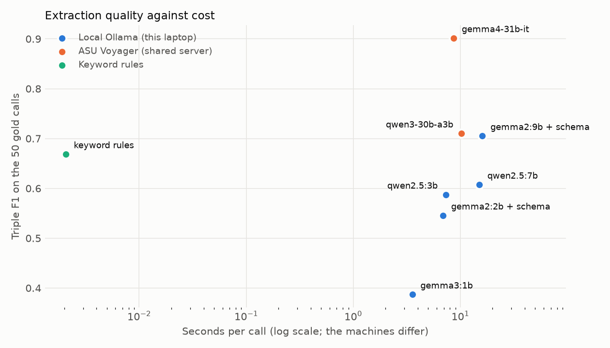
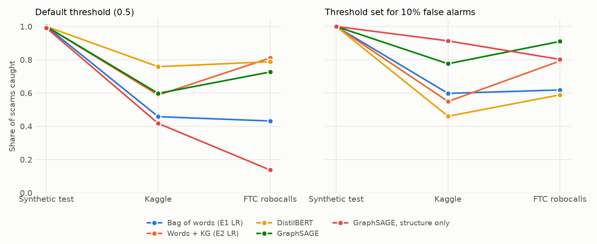
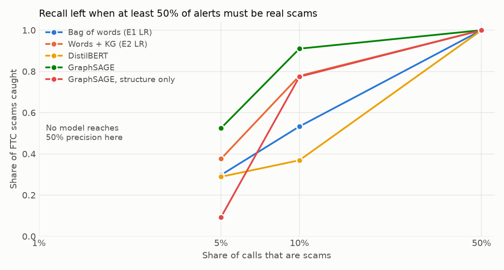
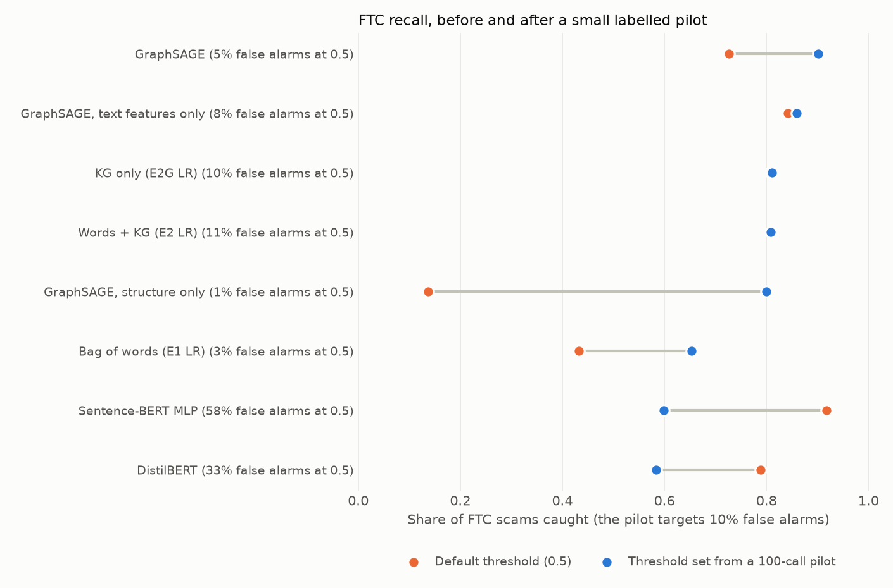
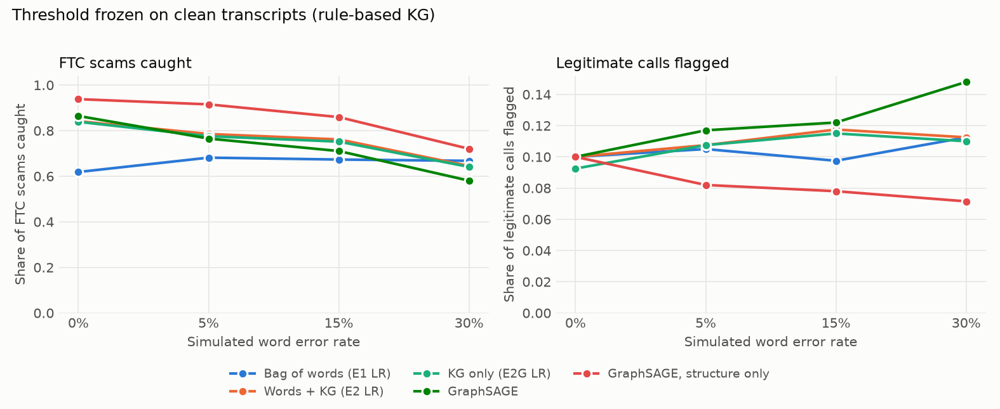
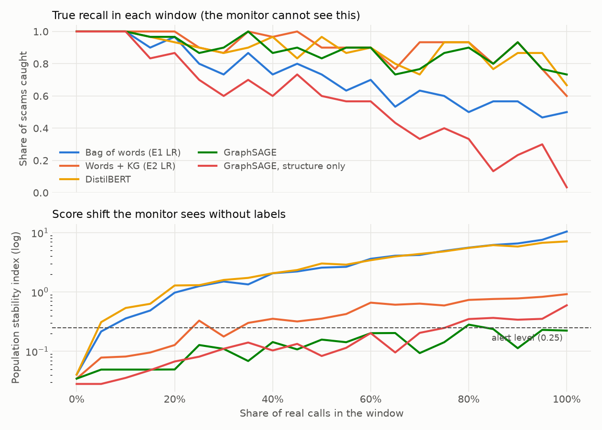
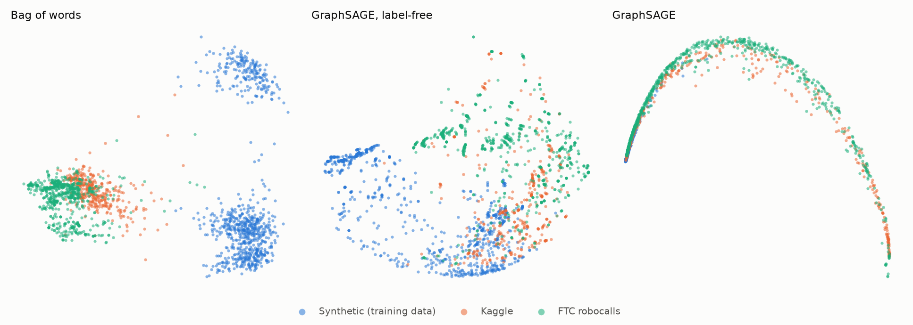
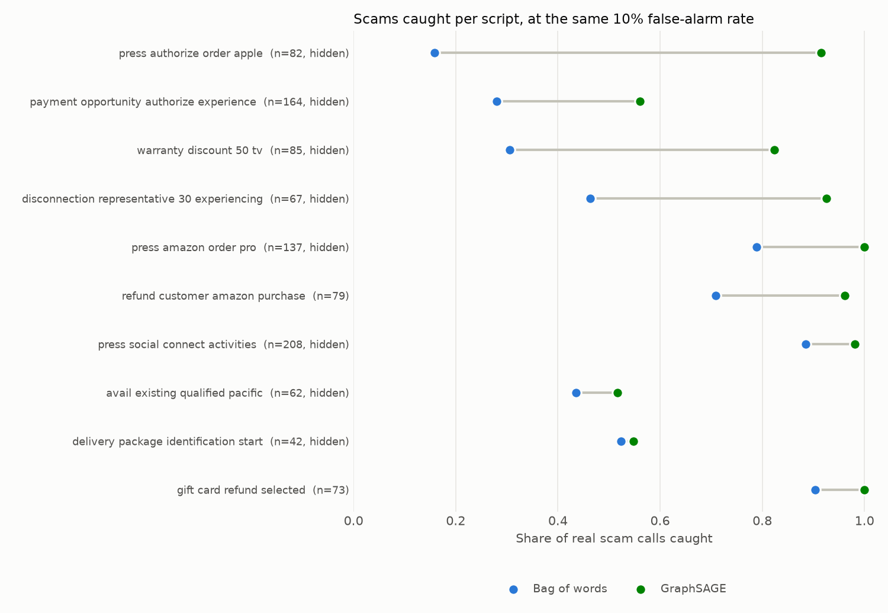

# Follow-up on the professor's feedback

Generated by `python -m scamkg feedback-report`. The committed results in `results/` are not changed by anything here.

## Main results

* **GraphSAGE catches scams bag of words misses.** At 10% false alarms, over 5 seeds: FTC 89% (sd 5%) against 62%; Kaggle 78% (sd 4%) against 60%. With no transcript words at all, structure alone gets 85% on Kaggle but an unstable 68% (sd 17%) on FTC.
* **"Completely misses" goes too far.** Bag of words flags 98% of scam types removed from synthetic training and recovers them as clusters better (F1 0.99 against 0.56). Its weakness is the move to real calls, not unseen scripts as such. GraphSAGE's clear win on unseen synthetic types is false alarms on unseen legitimate types (2% against 15%).
* **Small models do not replace Gemma on triple quality.** Gold F1: Gemma 31B 0.90 (0.87-0.93), gemma2:9b with schema 0.71 (0.65-0.75), keyword rules 0.67 (0.59-0.74), qwen2.5:3b with schema 0.58 (0.51-0.64), gemma3:1b with schema 0.38 (0.30-0.44). Schema enforcement raises conformance, not F1.
* **But detection mostly survives cheap serving** (GraphSAGE, 5 seeds). Gemma everywhere: PR-AUC 0.93 on Kaggle and 0.97 on FTC, recall at 10% false alarms 78% and 89%. Train on Gemma, serve with rules + qwen2.5:3b: PR-AUC 0.89 on Kaggle and 0.98 on FTC, recall at 10% false alarms 73% and 92%. Keyword rules everywhere, no LLM at all: PR-AUC 0.81 on Kaggle and 0.96 on FTC, recall at 10% false alarms 57% and 86%. The LLM earns its cost on Kaggle more than on FTC.
* **Rare scams are the hard limit.** At 0.5, GraphSAGE keeps 73% FTC recall whatever the scam share, but only 43% of its alerts are real at 5% scams and 13% at 1%. Requiring 50% precision at 5% scams leaves 52% recall (30% for bag of words). At 1% scams, 0 of 8 models reach 50% precision on this sample.
* **Noise erases the KG advantage.** FTC recall at a frozen threshold, clean to 30% word errors, rule KG: bag of words 62% to 67%, words + KG 84% to 65%, GraphSAGE 86% to 58%.
* **Much of the recall loss is the threshold.** A 100-call labelled pilot moves GraphSAGE from 73% to 90% FTC recall, with false alarms from 5% to 12%.
* **Recall can be watched without labels.** In a simulated drift, a warning came before recall fell by 10 points for 6 of the 7 models whose recall fell that far, and no model warned on a stream without drift. The share of unknown words alone tracks recall (Spearman -0.53 to -0.97).

## 1. Lighter extraction models

| extractor | runs on | size | memory (GB) | F1, 50 gold calls | F1 low | F1 high | agrees with Gemma, FTC | agrees with Gemma, Kaggle | s per call | p95 s | hours per 100k calls |
|---|---|---|---|---|---|---|---|---|---|---|---|
| gemma4-31b-it (v1_full) | voyager | 31B |  | 0.901 | 0.870 | 0.931 |  |  | 8.664 | 13.029 | 240.678 |
| qwen3-30b-a3b (v1_full) | voyager | 30B |  | 0.710 | 0.658 | 0.760 |  |  | 10.191 | 18.806 | 283.073 |
| gemma2:9b + schema (v1_full) | ollama | 9.2B | 6.380 | 0.705 | 0.654 | 0.749 |  |  | 16.064 | 23.549 | 446.215 |
| gemma2:9b (v1_full) | ollama | 9.2B | 6.380 | 0.690 | 0.637 | 0.734 |  |  | 17.861 | 28.360 | 496.143 |
| gemma2:9b + schema (v2_no_descriptors) | ollama | 9.2B | 6.380 | 0.683 | 0.628 | 0.734 |  |  | 15.079 | 22.288 | 418.862 |
| keyword rules | local |  |  | 0.669 | 0.593 | 0.738 | 0.692 | 0.445 | 0.002 | 0.005 | 0.057 |
| qwen2.5:7b (v2_no_descriptors) | ollama |  |  | 0.607 | 0.551 | 0.659 |  |  | 15.028 | 22.951 | 417.455 |
| qwen2.5:7b (v1_full) | ollama |  |  | 0.606 | 0.545 | 0.663 | 0.442 |  | 19.350 | 42.485 | 537.488 |
| qwen2.5:3b (v1_full) | ollama | 3.1B | 2.390 | 0.587 | 0.518 | 0.652 |  |  | 7.291 | 12.002 | 202.520 |
| qwen2.5:3b + schema (v1_full) | ollama | 3.1B | 2.390 | 0.578 | 0.505 | 0.643 | 0.441 | 0.436 | 4.077 | 9.157 | 113.263 |
| gemma2:2b + schema (v1_full) | ollama | 2.6B | 2.060 | 0.545 | 0.485 | 0.597 |  |  | 6.892 | 9.915 | 191.453 |
| gemma2:2b (v1_full) | ollama | 2.6B | 2.060 | 0.528 | 0.463 | 0.583 |  |  | 7.103 | 9.444 | 197.293 |
| qwen2.5:3b (v4_compact) | ollama | 3.1B | 2.390 | 0.486 | 0.425 | 0.546 |  |  | 3.666 | 6.484 | 101.842 |
| qwen2.5:3b + schema (v4_compact) | ollama | 3.1B | 2.390 | 0.482 | 0.420 | 0.536 |  |  | 4.011 | 8.644 | 111.427 |
| gemma2:2b (v4_compact) | ollama | 2.6B | 2.060 | 0.414 | 0.345 | 0.484 |  |  | 9.931 | 29.803 | 275.863 |
| gemma2:2b + schema (v4_compact) | ollama | 2.6B | 2.060 | 0.404 | 0.342 | 0.463 |  |  | 8.123 | 13.536 | 225.637 |
| gemma3:1b (v4_compact) | ollama | 999.89M | 0.950 | 0.387 | 0.331 | 0.439 |  |  | 3.561 | 5.627 | 98.927 |
| gemma3:1b + schema (v1_full) | ollama | 999.89M | 0.950 | 0.376 | 0.303 | 0.441 |  |  | 5.303 | 7.662 | 147.306 |
| gemma3:1b (v1_full) | ollama | 999.89M | 0.950 | 0.367 | 0.305 | 0.428 |  |  | 4.949 | 7.245 | 137.477 |
| gemma3:1b + schema (v4_compact) | ollama | 999.89M | 0.950 | 0.357 | 0.303 | 0.406 |  |  | 3.742 | 6.664 | 103.931 |

Limits: Gemma's latency comes from a shared Voyager server and the small models from an M1 Pro laptop, so seconds per call are not a fair race; the point is the hardware each one needs. F1 low / high is a 95% bootstrap interval over the 50 gold calls, so models a few points apart cannot be separated. The gold calls are all synthetic. On Kaggle and FTC calls there is no gold, so those columns measure agreement with Gemma, not accuracy, on the calls each run covers. Small runs that cover only gold calls have no agreement value.

### Rules first, LLM only when they find too little

The rule extractor is free (about 3 ms per call). A call with fewer than `min_triples` rule triples goes to the LLM; `llm_ollama_qwen2.5-3b_v1_full_constrained` supplies its triples here (escalate mode), so no LLM was re-run. `agree_*` compares with that same LLM's full answer; `llm_share` counts calls that LLM covers.

| min_triples | llm_share | llm_share_bothbosu | llm_share_kaggle | llm_share_ncsu | gold_f1 | agree_kaggle_f1 | agree_ncsu_f1 |
|---|---|---|---|---|---|---|---|
| 3.000 | 0.264 | 0.014 | 0.803 | 0.223 | 0.645 | 0.798 | 0.520 |
| 4.000 | 0.383 | 0.019 | 0.929 | 0.590 | 0.620 | 0.928 | 0.754 |

### Rules first, LLM only when they find too little

The rule extractor is free (about 3 ms per call). A call with fewer than `min_triples` rule triples goes to the LLM; `llm_voyager_gemma4-31b-it_v1_full_fb-qwen3-30b-a3b` supplies its triples here (escalate mode), so no LLM was re-run. `agree_*` compares with that same LLM's full answer; `llm_share` counts calls that LLM covers.

| min_triples | llm_share | llm_share_bothbosu | llm_share_kaggle | llm_share_ncsu | gold_f1 | agree_kaggle_f1 | agree_ncsu_f1 |
|---|---|---|---|---|---|---|---|
| 1.000 | 0.161 | 0.130 | 0.363 | 0.006 | 0.672 | 0.635 | 0.694 |
| 2.000 | 0.345 | 0.317 | 0.660 | 0.059 | 0.722 | 0.818 | 0.715 |
| 3.000 | 0.492 | 0.457 | 0.803 | 0.223 | 0.769 | 0.904 | 0.775 |
| 4.000 | 0.657 | 0.552 | 0.929 | 0.590 | 0.808 | 0.972 | 0.905 |
| 5.000 | 0.818 | 0.680 | 0.985 | 0.942 | 0.833 | 0.995 | 0.987 |
| 6.000 | 0.900 | 0.812 | 0.994 | 0.992 | 0.849 | 0.998 | 0.996 |

### Rules first, LLM only when they find too little

The rule extractor is free (about 3 ms per call). A call with fewer than `min_triples` rule triples goes to the LLM; `llm_ollama_qwen2.5-3b_v1_full_constrained` supplies its triples here (union mode), so no LLM was re-run. `agree_*` compares with that same LLM's full answer; `llm_share` counts calls that LLM covers.

| min_triples | llm_share | llm_share_bothbosu | llm_share_kaggle | llm_share_ncsu | gold_f1 | agree_kaggle_f1 | agree_ncsu_f1 |
|---|---|---|---|---|---|---|---|
| 3.000 | 0.264 | 0.014 | 0.803 | 0.223 | 0.665 | 0.725 | 0.502 |
| 4.000 | 0.383 | 0.019 | 0.929 | 0.590 | 0.667 | 0.806 | 0.678 |
| 99.000 | 0.501 | 0.031 | 1.000 | 1.000 | 0.678 | 0.845 | 0.826 |

### Does cheaper extraction hurt detection?

Same calls, same models and hyper-parameters; only the triples differ. `Train: Gemma` rows keep Gemma's triples for training calls and use the cheaper extractor only for calls scored later, which is where the cost recurs. GraphSAGE is a mean over 5 seeds. `kaggle` is scam against legitimate inside one data set, the fairer test. `ncsu+kaggle` puts FTC scams against Kaggle's legitimate calls, two data sets, so an extractor's quirks on either one can separate them: a cheap extractor beating Gemma there is not evidence that it is better. These runs use networkx graph features for every KG, while the committed results used Neo4j GDS, so Gemma's row differs slightly from `results/REPORT.md`; compare within this table.

| extraction_run | experiment | model | pr_auc_kaggle | pr_auc_ncsu+kaggle | recall_kaggle | recall_ncsu+kaggle | recall_at_fpr10_kaggle | recall_at_fpr10_ncsu+kaggle |
|---|---|---|---|---|---|---|---|---|
| Rules, then Gemma 31B below 3 facts (escalate) | E2 | lr | 0.863 | 0.933 | 0.458 | 0.551 | 0.489 | 0.607 |
| Rules, then Gemma 31B below 3 facts (escalate) | E2 | xgb | 0.795 | 0.890 | 0.471 | 0.638 | 0.377 | 0.525 |
| Rules, then Gemma 31B below 3 facts (escalate) | E2G | lr | 0.863 | 0.933 | 0.458 | 0.543 | 0.483 | 0.596 |
| Rules, then Gemma 31B below 3 facts (escalate) | E2G | xgb | 0.796 | 0.908 | 0.481 | 0.638 | 0.341 | 0.564 |
| Rules, then Gemma 31B below 3 facts (escalate) | E4 | graphsage (5 seeds) | 0.886 | 0.946 | 0.380 | 0.390 | 0.641 | 0.784 |
| Rules, then Gemma 31B below 4 facts (escalate) | E2 | lr | 0.873 | 0.932 | 0.562 | 0.738 | 0.573 | 0.757 |
| Rules, then Gemma 31B below 4 facts (escalate) | E2 | xgb | 0.709 | 0.857 | 0.603 | 0.825 | 0.288 | 0.150 |
| Rules, then Gemma 31B below 4 facts (escalate) | E2G | lr | 0.872 | 0.933 | 0.557 | 0.735 | 0.573 | 0.757 |
| Rules, then Gemma 31B below 4 facts (escalate) | E2G | xgb | 0.791 | 0.872 | 0.603 | 0.825 | 0.384 | 0.247 |
| Rules, then Gemma 31B below 4 facts (escalate) | E4 | graphsage (5 seeds) | 0.905 | 0.956 | 0.485 | 0.507 | 0.722 | 0.854 |
| Gemma 31B | E2 | lr | 0.867 | 0.940 | 0.580 | 0.818 | 0.522 | 0.760 |
| Gemma 31B | E2 | xgb | 0.689 | 0.827 | 0.379 | 0.759 | 0.303 | 0.332 |
| Gemma 31B | E2G | lr | 0.868 | 0.942 | 0.575 | 0.812 | 0.522 | 0.760 |
| Gemma 31B | E2G | xgb | 0.768 | 0.851 | 0.379 | 0.759 | 0.331 | 0.574 |
| Gemma 31B | E4 | graphsage (5 seeds) | 0.926 | 0.972 | 0.572 | 0.683 | 0.777 | 0.892 |
| Keyword rules | E2 | lr | 0.829 | 0.974 | 0.260 | 0.498 | 0.532 | 0.842 |
| Keyword rules | E2 | xgb | 0.849 | 0.931 | 0.260 | 0.473 | 0.646 | 0.756 |
| Keyword rules | E2G | lr | 0.818 | 0.972 | 0.260 | 0.492 | 0.522 | 0.839 |
| Keyword rules | E2G | xgb | 0.828 | 0.959 | 0.257 | 0.491 | 0.537 | 0.769 |
| Keyword rules | E4 | graphsage (5 seeds) | 0.807 | 0.963 | 0.294 | 0.498 | 0.567 | 0.865 |
| Train: Gemma 31B. Serve: cascade_k3_escalate__qwen2.5-3b + schema | E2 | lr | 0.885 | 0.967 | 0.542 | 0.714 | 0.766 | 0.921 |
| Train: Gemma 31B. Serve: cascade_k3_escalate__qwen2.5-3b + schema | E2 | xgb | 0.752 | 0.893 | 0.331 | 0.721 | 0.595 | 0.760 |
| Train: Gemma 31B. Serve: cascade_k3_escalate__qwen2.5-3b + schema | E2G | lr | 0.881 | 0.967 | 0.537 | 0.714 | 0.771 | 0.924 |
| Train: Gemma 31B. Serve: cascade_k3_escalate__qwen2.5-3b + schema | E2G | xgb | 0.752 | 0.894 | 0.331 | 0.721 | 0.595 | 0.760 |
| Train: Gemma 31B. Serve: cascade_k3_escalate__qwen2.5-3b + schema | E4 | graphsage (5 seeds) | 0.891 | 0.960 | 0.471 | 0.503 | 0.716 | 0.831 |
| Train: Gemma 31B. Serve: rules + qwen2.5-3b + schema | E2 | lr | 0.873 | 0.975 | 0.557 | 0.819 | 0.644 | 0.850 |
| Train: Gemma 31B. Serve: rules + qwen2.5-3b + schema | E2 | xgb | 0.734 | 0.872 | 0.387 | 0.777 | 0.422 | 0.777 |
| Train: Gemma 31B. Serve: rules + qwen2.5-3b + schema | E2G | lr | 0.873 | 0.976 | 0.552 | 0.816 | 0.649 | 0.854 |
| Train: Gemma 31B. Serve: rules + qwen2.5-3b + schema | E2G | xgb | 0.724 | 0.874 | 0.387 | 0.777 | 0.448 | 0.777 |
| Train: Gemma 31B. Serve: rules + qwen2.5-3b + schema | E4 | graphsage (5 seeds) | 0.888 | 0.978 | 0.511 | 0.775 | 0.733 | 0.919 |
| Train: Gemma 31B. Serve: qwen2.5-3b + schema | E2 | lr | 0.861 | 0.970 | 0.481 | 0.680 | 0.725 | 0.893 |
| Train: Gemma 31B. Serve: qwen2.5-3b + schema | E2 | xgb | 0.693 | 0.870 | 0.288 | 0.617 | 0.448 | 0.670 |
| Train: Gemma 31B. Serve: qwen2.5-3b + schema | E2G | lr | 0.853 | 0.968 | 0.468 | 0.679 | 0.725 | 0.899 |
| Train: Gemma 31B. Serve: qwen2.5-3b + schema | E2G | xgb | 0.728 | 0.889 | 0.288 | 0.617 | 0.539 | 0.729 |
| Train: Gemma 31B. Serve: qwen2.5-3b + schema | E4 | graphsage (5 seeds) | 0.875 | 0.969 | 0.468 | 0.703 | 0.685 | 0.867 |
| Train: Gemma 31B. Serve: rule | E2 | lr | 0.811 | 0.955 | 0.382 | 0.677 | 0.496 | 0.767 |
| Train: Gemma 31B. Serve: rule | E2 | xgb | 0.683 | 0.874 | 0.293 | 0.690 | 0.471 | 0.735 |
| Train: Gemma 31B. Serve: rule | E2G | lr | 0.802 | 0.957 | 0.382 | 0.665 | 0.501 | 0.785 |
| Train: Gemma 31B. Serve: rule | E2G | xgb | 0.684 | 0.874 | 0.293 | 0.690 | 0.471 | 0.735 |
| Train: Gemma 31B. Serve: rule | E4 | graphsage (5 seeds) | 0.794 | 0.943 | 0.338 | 0.449 | 0.577 | 0.843 |

### Do extractors keep the facts on noisy transcripts?

50 calls per data set. Gemma itself could not be re-run on noisy text (no Voyager access on this machine). First table: agreement with Gemma on the clean transcript.

| dataset | extractor | clean | light | medium | heavy |
|---|---|---|---|---|---|
| kaggle | keyword rules | 0.366 | 0.383 | 0.323 | 0.271 |
| kaggle | qwen2.5:3b + schema | 0.412 | 0.378 | 0.352 | 0.296 |
| ncsu | keyword rules | 0.615 | 0.564 | 0.512 | 0.497 |
| ncsu | qwen2.5:3b + schema | 0.429 | 0.425 | 0.362 | 0.357 |

Second table: agreement with the extractor's own answer on the clean transcript. The small LLM does not rescue noisy calls: it keeps fewer of its own facts than the rules do.

| dataset | extractor | clean | light | medium | heavy |
|---|---|---|---|---|---|
| kaggle | keyword rules | 1.000 | 0.923 | 0.804 | 0.727 |
| kaggle | qwen2.5:3b + schema | 1.000 | 0.638 | 0.447 | 0.352 |
| ncsu | keyword rules | 1.000 | 0.916 | 0.824 | 0.718 |
| ncsu | qwen2.5:3b + schema | 1.000 | 0.649 | 0.565 | 0.543 |

## 2. Recall from synthetic data to noisy, imbalanced FTC calls

### Recall ladder

Default threshold 0.5, 95% bootstrap interval. `recall_at_target_fpr` sets the threshold for 10% false alarms on the legitimate calls of the same step (in-sample). Single committed run per model.

| model | stage | n_scams | recall | recall_ci_low | recall_ci_high | false_alarm_rate | recall_at_target_fpr | status |
|---|---|---|---|---|---|---|---|---|
| Bag of words (E1 LR) | Synthetic test | 120 | 1.000 | 1.000 | 1.000 | 0.000 | 1.000 | OK |
| Bag of words (E1 LR) | Kaggle | 393 | 0.458 | 0.410 | 0.506 | 0.030 | 0.598 | ALERT |
| Bag of words (E1 LR) | FTC robocalls | 713 | 0.432 | 0.396 | 0.466 | 0.030 | 0.619 | ALERT |
| Words + KG (E2 LR) | Synthetic test | 120 | 1.000 | 1.000 | 1.000 | 0.000 | 1.000 | OK |
| Words + KG (E2 LR) | Kaggle | 393 | 0.588 | 0.539 | 0.639 | 0.110 | 0.550 | ALERT |
| Words + KG (E2 LR) | FTC robocalls | 713 | 0.811 | 0.778 | 0.839 | 0.110 | 0.792 | WARN |
| DistilBERT | Synthetic test | 120 | 1.000 | 1.000 | 1.000 | 0.000 | 1.000 | OK |
| DistilBERT | Kaggle | 393 | 0.758 | 0.718 | 0.799 | 0.330 | 0.461 | ALERT |
| DistilBERT | FTC robocalls | 713 | 0.788 | 0.757 | 0.819 | 0.330 | 0.589 | WARN |
| GraphSAGE | Synthetic test | 120 | 1.000 | 1.000 | 1.000 | 0.000 | 1.000 | OK |
| GraphSAGE | Kaggle | 393 | 0.598 | 0.550 | 0.644 | 0.050 | 0.776 | ALERT |
| GraphSAGE | FTC robocalls | 713 | 0.727 | 0.691 | 0.759 | 0.050 | 0.910 | ALERT |
| GraphSAGE, structure only | Synthetic test | 120 | 0.992 | 0.975 | 1.000 | 0.000 | 1.000 | OK |
| GraphSAGE, structure only | Kaggle | 393 | 0.417 | 0.372 | 0.463 | 0.012 | 0.913 | ALERT |
| GraphSAGE, structure only | FTC robocalls | 713 | 0.137 | 0.112 | 0.163 | 0.012 | 0.802 | ALERT |

### As scams get rare

FTC robocalls (713) against Kaggle's legitimate calls (400), reweighted to each scam share. At a fixed threshold recall cannot change with prevalence, but precision collapses, so keeping alerts trustworthy means raising the threshold, and that is where recall goes. `n/a`: no threshold reaches that precision on this sample (zero false alarms among 400 calls is treated as about 1 in 401, not as zero).

| model | prevalence | recall_at_threshold | precision_at_threshold | false_alarms_per_1000_calls | scams_missed_per_1000_calls | recall_at_precision_0.5 | recall_at_precision_0.8 |
|---|---|---|---|---|---|---|---|
| Bag of words (E1 LR) | 0.500 | 0.432 | 0.935 | 15.000 | 284.011 | 1.000 | 0.819 |
| Bag of words (E1 LR) | 0.100 | 0.432 | 0.615 | 27.000 | 56.802 | 0.533 | 0.143 |
| Bag of words (E1 LR) | 0.050 | 0.432 | 0.431 | 28.500 | 28.401 | 0.297 |  |
| Bag of words (E1 LR) | 0.010 | 0.432 | 0.127 | 29.700 | 5.680 |  |  |
| Words + KG (E2 LR) | 0.500 | 0.811 | 0.881 | 55.000 | 94.670 | 1.000 | 0.983 |
| Words + KG (E2 LR) | 0.100 | 0.811 | 0.450 | 99.000 | 18.934 | 0.778 | 0.119 |
| Words + KG (E2 LR) | 0.050 | 0.811 | 0.279 | 104.500 | 9.467 | 0.376 |  |
| Words + KG (E2 LR) | 0.010 | 0.811 | 0.069 | 108.900 | 1.893 |  |  |
| GraphSAGE | 0.500 | 0.727 | 0.936 | 25.000 | 136.746 | 1.000 | 0.982 |
| GraphSAGE | 0.100 | 0.727 | 0.618 | 45.000 | 27.349 | 0.910 | 0.233 |
| GraphSAGE | 0.050 | 0.727 | 0.433 | 47.500 | 13.675 | 0.525 |  |
| GraphSAGE | 0.010 | 0.727 | 0.128 | 49.500 | 2.735 |  |  |

### What a small labelled pilot recovers

The threshold is set on 100 labelled calls from the new domain (50 scams, 50 legitimate; target 10% false alarms) and scored on the rest, over 200 draws. Recall is not free: compare the false-alarm columns.

| model | frozen_recall | frozen_false_alarm_rate | recall | recall_sd | false_alarm_rate | false_alarm_sd |
|---|---|---|---|---|---|---|
| Bag of words (E1 LR) | 0.432 | 0.030 | 0.653 | 0.097 | 0.113 | 0.051 |
| Words + KG (E2 LR) | 0.811 | 0.110 | 0.809 | 0.067 | 0.112 | 0.047 |
| KG only (E2G LR) | 0.808 | 0.105 | 0.810 | 0.065 | 0.112 | 0.047 |
| DistilBERT | 0.788 | 0.330 | 0.584 | 0.084 | 0.115 | 0.048 |
| Sentence-BERT MLP | 0.917 | 0.580 | 0.599 | 0.081 | 0.115 | 0.047 |
| GraphSAGE | 0.727 | 0.050 | 0.902 | 0.059 | 0.117 | 0.054 |
| GraphSAGE, text features only | 0.842 | 0.082 | 0.860 | 0.052 | 0.113 | 0.046 |
| GraphSAGE, structure only | 0.137 | 0.012 | 0.800 | 0.117 | 0.110 | 0.049 |

### Simulated speech-to-text noise

Models trained once on clean calls, threshold frozen at 10% false alarms on clean calls, then scored on noisy external calls (0%, 5%, 15%, 30% word errors). GraphSAGE: mean of 5 seeds. All KGs here come from the keyword rules, since only they can re-extract every noisy call instantly. Simulated noise, not one real recognizer.

| model | clean | light | medium | heavy |
|---|---|---|---|---|
| Bag of words (E1 LR) | 0.619 | 0.682 | 0.673 | 0.668 |
| GraphSAGE | 0.865 | 0.765 | 0.711 | 0.581 |
| GraphSAGE, structure only | 0.938 | 0.915 | 0.859 | 0.720 |
| KG only (E2G LR) | 0.839 | 0.776 | 0.752 | 0.641 |
| Words + KG (E2 LR) | 0.842 | 0.785 | 0.762 | 0.645 |

### Warning signals that need no labels

| stage | model | n_calls | alert_rate | score_psi | unknown_word_rate | no_kg_facts_rate | status |
|---|---|---|---|---|---|---|---|
| synthetic_test | Bag of words (E1 LR) | 240 | 0.500 | 0.000 | 0.006 | 0.054 | OK |
| synthetic_test | Words + KG (E2 LR) | 240 | 0.500 | 0.000 | 0.006 | 0.054 | OK |
| synthetic_test | GraphSAGE | 240 | 0.500 | 0.000 | 0.006 | 0.054 | OK |
| kaggle | Bag of words (E1 LR) | 793 | 0.242 | 9.507 | 0.143 | 0.035 | ALERT |
| kaggle | Words + KG (E2 LR) | 793 | 0.347 | 0.833 | 0.143 | 0.035 | ALERT |
| kaggle | GraphSAGE | 793 | 0.322 | 0.305 | 0.143 | 0.035 | ALERT |
| ncsu_robocalls | Bag of words (E1 LR) | 1113 | 0.288 | 10.255 | 0.114 | 0.029 | ALERT |
| ncsu_robocalls | Words + KG (E2 LR) | 1113 | 0.559 | 0.700 | 0.114 | 0.029 | ALERT |
| ncsu_robocalls | GraphSAGE | 1113 | 0.483 | 0.323 | 0.114 | 0.029 | ALERT |

### A simulated deployment

21 windows of 300 calls at 10% scams, drifting from 0% to 100% real calls. A signal must hold for 2 windows to count. `lead_windows` is how many windows the first warning came before recall fell by 10 points; negative means after. Empty: recall never fell that far. `no_drift_warning_windows`: share of windows that warned on a stream that never drifts, one stream per model. The alert levels are starting points, not validated limits.

| model | baseline_recall | final_recall | first_warning_window | first_recall_drop_window | lead_windows | spearman_recall_vs_unknown_words | spearman_recall_vs_psi | no_drift_warning_windows |
|---|---|---|---|---|---|---|---|---|
| Bag of words (E1 LR) | 1.000 | 0.511 | 1 | 5.000 | 4.000 | -0.957 | -0.961 | 0.000 |
| Words + KG (E2 LR) | 1.000 | 0.767 | 4 | 19.000 | 15.000 | -0.714 | -0.742 | 0.000 |
| KG only (E2G LR) | 1.000 | 0.767 | 4 | 12.000 | 8.000 | -0.722 | -0.732 | 0.000 |
| DistilBERT | 1.000 | 0.800 | 1 | 13.000 | 12.000 | -0.705 | -0.698 | 0.000 |
| Sentence-BERT MLP | 1.000 | 0.933 | 4 |  |  | -0.531 | -0.501 | 0.000 |
| GraphSAGE | 1.000 | 0.811 | 5 | 13.000 | 8.000 | -0.726 | -0.753 | 0.000 |
| GraphSAGE, text features only | 1.000 | 0.889 | 8 | 19.000 | 11.000 | -0.769 | -0.734 | 0.000 |
| GraphSAGE, structure only | 1.000 | 0.189 | 6 | 3.000 | -3.000 | -0.970 | -0.913 | 0.000 |

## 3. Hidden scripts with GraphSAGE

### Does GraphSAGE catch what bag of words misses?

Unseen data sets, over seeds:

| model | dataset | seeds | recall_at_10pct_false_alarms | recall_at_10pct_false_alarms_sd | recall_default_threshold | recall_default_threshold_sd |
|---|---|---|---|---|---|---|
| Bag of words | kaggle | 1 | 0.598 |  | 0.458 |  |
| GraphSAGE | kaggle | 5 | 0.777 | 0.038 | 0.572 | 0.116 |
| GraphSAGE, structure only | kaggle | 5 | 0.846 | 0.046 | 0.373 | 0.021 |
| GraphSAGE, KG facts | kaggle | 5 | 0.758 | 0.092 | 0.476 | 0.049 |
| Bag of words | ncsu | 1 | 0.619 |  | 0.432 |  |
| GraphSAGE | ncsu | 5 | 0.892 | 0.054 | 0.683 | 0.160 |
| GraphSAGE, structure only | ncsu | 5 | 0.675 | 0.167 | 0.088 | 0.075 |
| GraphSAGE, KG facts | ncsu | 5 | 0.696 | 0.174 | 0.274 | 0.111 |

Call by call (1,106 real scams; one seed; McNemar test):

| challenger | operating_point | scams | bow_recall | challenger_recall | missed_by_bow_caught | caught_by_bow_missed | p_value |
|---|---|---|---|---|---|---|---|
| GraphSAGE | threshold 0.5 | 1106 | 0.441 | 0.653 | 276 | 42 | 0.000 |
| GraphSAGE | 10% false alarms | 1106 | 0.611 | 0.858 | 299 | 26 | 0.000 |
| GraphSAGE, structure only | threshold 0.5 | 1106 | 0.441 | 0.275 | 66 | 250 | 0.000 |
| GraphSAGE, structure only | 10% false alarms | 1106 | 0.611 | 0.875 | 322 | 30 | 0.000 |
| GraphSAGE, text features only | threshold 0.5 | 1106 | 0.441 | 0.787 | 404 | 22 | 0.000 |
| GraphSAGE, text features only | 10% false alarms | 1106 | 0.611 | 0.810 | 271 | 51 | 0.000 |
| E4__graphsage_kg | threshold 0.5 | 1106 | 0.441 | 0.314 | 89 | 230 | 0.000 |
| E4__graphsage_kg | 10% false alarms | 1106 | 0.611 | 0.741 | 221 | 78 | 0.000 |
| Words + KG (E2 LR) | threshold 0.5 | 1106 | 0.441 | 0.732 | 367 | 46 | 0.000 |
| Words + KG (E2 LR) | 10% false alarms | 1106 | 0.611 | 0.706 | 201 | 96 | 0.000 |
| KG only (E2G LR) | threshold 0.5 | 1106 | 0.441 | 0.730 | 365 | 46 | 0.000 |
| KG only (E2G LR) | 10% false alarms | 1106 | 0.611 | 0.713 | 207 | 95 | 0.000 |

### Clusters of scam calls, same k = 16 for every space

`dataset_mixing`: 0 = every cluster holds one data set, 1 = evenly mixed. `real_calls_linked_to_training`: share of real calls in clusters that also hold training calls. Other values of k are in `script_methods.csv`.

| method | silhouette | nmi_with_synthetic_types | dataset_mixing | real_calls_linked_to_training | word_similarity_within_cluster | kg_similarity_within_cluster |
|---|---|---|---|---|---|---|
| Bag of words | 0.284 | 0.982 | 0.088 | 0.101 | 0.278 | 0.444 |
| GraphSAGE, label-free | 0.346 | 0.373 | 0.419 | 0.309 | 0.154 | 0.326 |
| GraphSAGE, KG facts | 0.327 | 0.285 | 0.573 | 0.352 | 0.130 | 0.253 |
| GraphSAGE | 0.269 | 0.396 | 0.644 | 0.454 | 0.133 | 0.263 |
| GraphSAGE, structure only | 0.399 | 0.238 | 0.597 | 0.306 | 0.132 | 0.249 |
| Sentence-BERT | 0.169 | 0.967 | 0.205 | 0.103 | 0.258 | 0.444 |

### The scripts

Defined by label-free GraphSAGE. 8 of 16 are hidden (under 5% training calls), holding 847 real scam calls. Recall at the same 10% false alarms: bag of words 54% against GraphSAGE 82% in hidden scripts; 89% against 99% in the others.

| script | calls | training_share | hidden | signature | top_words | bow_recall | graphsage_recall | missed_by_bow_caught_by_graphsage | caught_by_bow_missed_by_graphsage |
|---|---|---|---|---|---|---|---|---|---|
| 12 | 82 | 0.000 | True | fear | press authorize order apple amazon placed | 0.159 | 0.915 | 63 | 1 |
| 0 | 164 | 0.000 | True | reward+urgency -> money | payment opportunity authorize experience 999 enjoy | 0.280 | 0.561 | 49 | 3 |
| 13 | 85 | 0.000 | True | reward+urgency | warranty discount 50 tv qualified 1447 | 0.306 | 0.824 | 44 | 0 |
| 7 | 67 | 0.000 | True | utility_company -> urgency+threat | disconnection representative 30 experiencing automated minutes | 0.463 | 0.925 | 32 | 1 |
| 9 | 137 | 0.000 | True | retailer_customer_service -> fear+urgency | press amazon order pro authorize account | 0.788 | 1.000 | 29 | 0 |
| 14 | 208 | 0.000 | True | government_agent -> fear+threat | press social connect activities legal officer | 0.885 | 0.981 | 20 | 0 |
| 4 | 63 | 0.016 | True | reward+urgency | avail existing qualified pacific student 50 | 0.435 | 0.516 | 16 | 11 |
| 5 | 42 | 0.000 | True | delivery_service -> personal_info | delivery package identification start billing birthdate | 0.524 | 0.548 | 9 | 8 |
| 6 | 212 | 0.627 | False | retailer_customer_service -> reward+urgency -> personal_info+bank_account | refund customer amazon purchase information bank | 0.709 | 0.962 | 21 | 1 |
| 15 | 168 | 0.565 | False | prize_or_lottery+retailer_customer_service -> reward+urgency -> personal_info+bank_account | gift card refund selected bank walmart | 0.904 | 1.000 | 7 | 0 |
| 3 | 116 | 0.578 | False | prize_or_lottery -> reward+urgency -> personal_info+ssn | gift card company selected rewards just | 0.878 | 1.000 | 6 | 0 |
| 10 | 114 | 0.175 | False | reward+fear -> money -> bank_transfer | credit bank card funds transfer account | 0.957 | 0.979 | 3 | 1 |
| 1 | 232 | 0.832 | False | tech_support+government_agent -> fear+urgency -> remote_access+ssn | computer virus fix windows badge okay | 1.000 | 1.000 | 0 | 0 |
| 2 | 90 | 0.800 | False | government_agent+tech_support -> fear+urgency -> ssn+personal_info | social security okay badge need issue | 1.000 | 1.000 | 0 | 0 |
| 8 | 68 | 0.779 | False | tech_support+government_agent -> urgency+reward -> ssn+money | refund okay need sounds just information | 1.000 | 1.000 | 0 | 0 |
| 11 | 57 | 0.789 | False | tech_support+government_agent -> fear+urgency -> remote_access+ssn | computer virus windows 1234 800 infected | 1.000 | 1.000 | 0 | 0 |

A script here means calls sharing KG facts, and that is not always one story. Four transcripts per hidden cluster were read, unlabelled and only as a spot check: Social Security suspension, utility disconnection and Amazon account clusters read as one script, while others share behaviour (reward and urgency, or fear and press 1) across different stories. `kg_similarity` shows how tight each cluster is; read `script_assignments.csv` before naming one. GraphSAGE recall per script is one seed.

### A script removed from training

Mean over held-out BothBosu types. `flag_rate`: recall for a held-out scam type, false-alarm rate for a held-out legitimate type. `own_cluster_f1`: how cleanly the type comes out as one cluster. This synthetic data has very different vocabulary per type, which suits bag of words.

| held_out_class | model | flag_rate | pr_auc | recall_at_10pct_false_alarms | own_cluster_f1 |
|---|---|---|---|---|---|
| legitimate | Bag of words | 0.149 | 1.000 |  | 0.924 |
| legitimate | GraphSAGE | 0.018 | 1.000 |  | 0.453 |
| legitimate | GraphSAGE, KG facts | 0.065 | 1.000 |  | 0.536 |
| legitimate | GraphSAGE, label-free |  |  |  | 0.631 |
| legitimate | GraphSAGE, structure only | 0.015 | 0.997 |  | 0.550 |
| scam | Bag of words | 0.985 | 1.000 | 1.000 | 0.986 |
| scam | GraphSAGE | 0.927 | 1.000 | 0.999 | 0.668 |
| scam | GraphSAGE, KG facts | 0.985 | 1.000 | 1.000 | 0.509 |
| scam | GraphSAGE, label-free |  |  |  | 0.557 |
| scam | GraphSAGE, structure only | 0.995 | 1.000 | 1.000 | 0.510 |
